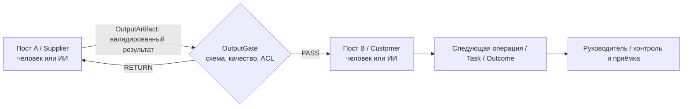

# BMOS Agent Platform — AI Control Layer, функциональные посты и SIPOC handoff

**Статус:** архитектурный проект (13.11.2026), не реализация. Основание: [Issue #76](https://github.com/rimanfatykhov-arch/bms24/issues/76), [Issue #75](https://github.com/rimanfatykhov-arch/bms24/issues/75), [ADR-0007](../adr/ADR-0007-bmos-ai-control-layer-timeweb-provider-PROPOSED.md). RC30, production, staging и Moodle Core не изменять.

## 1. Базовый принцип

Функциональный пост в ОФС определяет **продукт/ЦКП, функции, метрики, полномочия и потребителей результата**. Его фактический исполнитель может быть человеком, ИИ-агентом или гибридной командой. Пост и история процесса сохраняются при смене исполнителя.

По SIPOC выход одного процесса или шага является **управляемым входом** следующего. Обмен между постами осуществляется не через произвольный общий чат и не через передачу полной памяти LLM, а через версионированные результаты с контрактами, provenance и разрешениями.

## 2. Двухуровневая архитектура

- **BMOS Agent Platform / AI Control Layer** владеет идентификацией, принадлежностью к компании, назначением на пост, правами, описанием SIPOC-переходов, управлением задачами, инструментами, аудитом, бюджетами, передачей результатов и приёмкой.
- **Timeweb Cloud AI Gateway Adapter** (первый ModelProvider) предоставляет доступ к языковым моделям, но не хранит канонические полномочия BMS, бизнес-процессы или правила маршрутизации результатов. Base URL, capabilities, model support, pricing and legal/data processing must be verified against https://timeweb.cloud/docs/ai-gateway before first live integration.
- **BMS Public API v1** остаётся read-only; API v2 ограниченных действий не имеет прямого SQL-доступа. Выполняемые команды проходят канонические службы BMS и authorisation, а не LLM prompt.

## 3. Канонические сущности (предложение к ADR/ERD, НЕ новые таблицы)

| Концепт | Обязательные поля | Защита |
|---|---|---|
| `FunctionalPost` | Existing Position UUID, company UUID, CKP, required competencies, manager, metrics | Использовать текущий канонический пост; не дублировать Position |
| `WorkPrincipal` | Principal UUID, type human/ai_agent/service_integration, status, company, human sponsor | Не подменять Moodle user ID агентом |
| `PositionOccupancy` | Post UUID, principal UUID, effective date, mode human/ai/hybrid, assignment scopes | Назначение не переносит автоматически RBAC и исторические задачи |
| `ProcessStepContract` | Process revision, step UUID, supplier post, customer post, input/output schema, acceptance criteria, data classification, deadline | Версионируется вместе с утверждённой BPMN/SIPOC архитектурой |
| `OutputArtifact` | Artifact UUID, source step/run/task, company, type/schema version, data/file references, hash, provenance, producer principal/post, state | Раздельные права чтения и передачи; неизменяемая принятая редакция |
| `ProcessHandoff` | Handoff UUID, artifact UUID, from/to posts, expected revision, idempotency, correlation, status, timestamps, decision, reason | Запрет cross-company, replay и обхода output gate |
| `AgentRun` | Principal, post, model/provider, tool, correlation, status, cost, evidence, error | No secret / raw private prompt in public log |
| `ApprovalRequest` | Object, human approver, status, audit, deadline | AI не может утвердить высокорисковую операцию по умолчанию |

Existing `task.assigneeid` remains canonical Moodle human user; `dutypositionuuid` remains explicit position responsibility. Agent allocations and created actions belong to a **separate typed attribution layer**. Historical assignee, private attachments, membership and authorization must not be silently rewritten.

## 4. SIPOC output→input protocol

1. **Design:** в SIPOC у каждого выхода есть поставщик (пост/функция), внутренний потребитель (пост), формат/JSON Schema или document type, обязательные поля, показатели качества, чувствительность, timeout и критерии принятия.
2. **Produce:** пост А создаёт OutputArtifact через BMS domain service. Любой исполнитель (human/agent) указывает principal type, actor, company UUID, task/process instance, process revision, event/correlation ID.
3. **Validate:** output gate делает структурную проверку и бизнес-проверку качества/полномочий/версии. LLM оценка может быть вспомогательной, но не заменяет детерминированные правила и обязательное согласование.
4. **Publish:** атомарно сохранить неизменяемую редакцию результата, запись ProcessHandoff и domain outbox event. Интеграционный consumer получает event at-least-once и обязан deduplicate по stable key.
5. **Consume:** пост Б получает **только** разрешённую проекцию входа (field-level/file ACL), сверяет accepted schema/revision, может принять, возвратить с reason или направить на human approval. Не получает полную историю/память поста А.
6. **Advance:** после валидной приёмки BMS создаёт/активирует следующий разрешённый шаг процесса/каноническую задачу. Retry / timeout / failure не должны создавать дубликатов. Авторизованный human owner видит сбой, SLA и escalation.
7. **Audit:** сохраняются оба поста, фактические principals, входные/выходные ревизии, решение, время, модель/инструмент при агентном исполнении, проверка полномочий и итог. Нет неконтролируемого agent-to-agent side channel.

### Состояния handoff

`draft -> submitted -> validated -> delivered -> accepted`; ответвления `rejected/returned`, `needs_human_approval`, `expired`, `failed`, `cancelled`. Только разрешённые переходы, optimistic concurrency и immutable audit. `accepted` не означает автоматическую внешнюю публикацию, оплату или закрытие бизнес-процесса.

## 5. Пример: продажа и расчёт

SIPOC «Квалификация запроса»: вход — заявка клиента; поставщик — канал продаж; **пост A: ИИ-квалификатор**; выход — валидированная карточка запроса с обязательными параметрами. Следующий внутренний потребитель — **пост Б: ИИ-расчётчик**.

Пост Б получает карточку через `process_handoff.accept`, формирует черновик коммерческого предложения и подтверждённые расчётные данные; для отсутствующего параметра возвращает `returned` на пост A. После прохождения output gate передаёт результат **посту руководителя** на согласование; только разрешённое действие руководителя запускает внешнюю отправку.

Тип исполнителя не меняет SIPOC-контракт: человеческий менеджер также может занимать A или Б.

## 6. API v2 — проектные контракты

API read/write с едиными server-side checks company UUID / principal / occupancy / object scope / revision / idempotency, strict input validation:
- `GET /api/v2/processes/{id}/steps`, `GET /api/v2/positions/{uuid}/inbox`
- `POST /api/v2/process-runs/{id}/outputs` (создать draft, schema validated)
- `POST /api/v2/handoffs/{uuid}/submit`, `/accept`, `/return`, `/request-approval` (по явному scope и policy)
- `GET /api/v2/handoffs/{uuid}`, `GET /api/v2/agents/{uuid}/runs`
- `GET/POST /api/v2/daily-reports` с раздельной typed attribution; `accept`/ `return` — human manager в первом релизе.

URL-формы **предлагаемые**, не заявления о существующих HTTP маршрутах в Moodle. Реализацию определять согласно Moodle external functions и маршрутам BMS UI; API client не может вызвать SQL. Webhooks через проверенный eventout, не через произвольный чат.

## 7. Guardrails для ИИ-постов

- Не давать агентам human session/full RBAC автоматически, даже если они назначены на пост. Нужны отдельные ограниченные grants, срок действия, revoke и kill switch.
- Межпостовая передача разрешена только по согласованной схеме SIPOC и company/object ACL; недоверенный вход (MAX сообщения, документы, prompt injection) не является командой к смене бизнес-правил.
- Для `human/ai/hybrid` один и тот же output contract и качества; различается подтверждение фактического исполнителя. Human approval обязателен для изменений прав, платежей, внешней публикации и других high-risk side effects.
- Контроль контекста до запроса к Timeweb AI Gateway; минимизация персональных данных, лимит стоимости по компании/агенту, аудит расходов.
- При отключении модели или шлюза результат не теряется: очередь, bounded retry, state-machine/error handling; необратимых повторных операций нет.

## 8. Roadmap и acceptance

- **BMOS-A0 / RC32–RC33 design:** ADR по Actor/Occupancy и ProcessHandoff; reconciliation существующих Position/SIPOC/BPMN, domain ERD, API v2 schema, ownership, user journey, threat model.
- **BMOS-A1 / RC33:** компания/пост/агент principal registry и minimal permissions; корпоративная лента/MAX через тот же API/outbox; первый SIPOC artifact/handoff read model.
- **BMOS-A2 / RC34:** полноценный handoff state machine + daily reports human/AI с приёмкой руководителем, task/metric linking, audit.
- **BMOS-A3 / dedicated pilot after RC34:** Timeweb adapter и один изолированно протестированный AI functional post, передающий продукт другому посту через SIPOC/ProcessHandoff; human approval and kill switch.
- **BMOS-A4:** safe multi-agent orchestration, handoff graphs, SLAs, bounded automation and billing after proof of demand.

**Минимальный E2E тест:** компания A, пост A (AI) → валидированный output → пост Б (human или AI) → approval руководителя. Проверить rejected incomplete schema, stale revision, revoked agent, unauthorized company B, replay/double event, file ACL, blocked provider, human override, idempotency, no history mutation. MariaDB/Percona + HTTP/browser tests; cannot mark PASS without actual execution.

## 9. Non-goals

Не менять RC30, не запускать production AI или Timeweb API, не назначать агентам реальные посты/права, не строить глобальный gateway или многомодельный кэш сейчас. Все указанные функции — архитектура будущих релизов.
