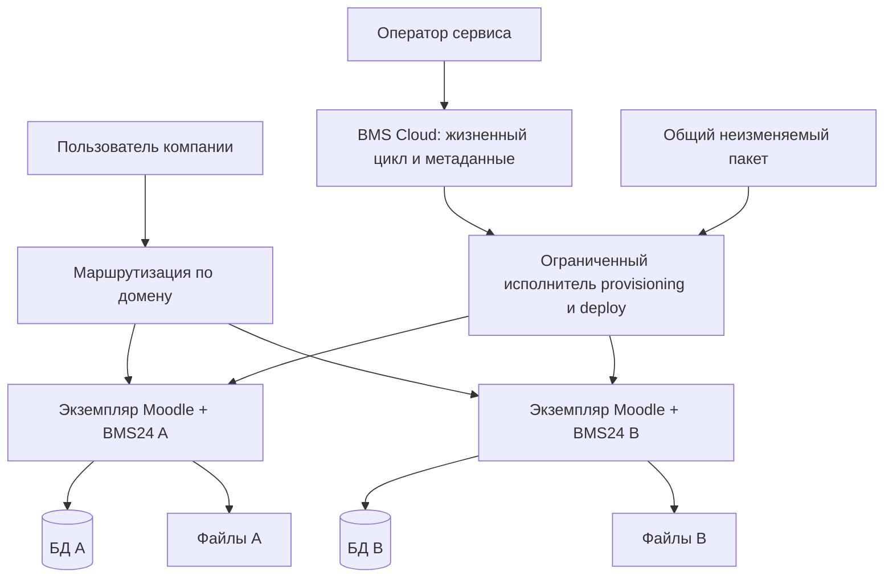

# BMS24: общая архитектура

Дата: 14.11.2026. Консолидированное описание существующих границ и целевых предложений.
[План и статусы решений](../ROADMAP.md) · [MVP](../product/SAAS_MVP.md) · [предлагаемый ADR изоляции](../adr/ADR-SAAS-001-tenant-isolation-PROPOSED.md).

## Существующие репозиторные границы

Основания: [01_ARCHITECTURE_BOUNDARIES](../01_ARCHITECTURE_BOUNDARIES.md), [12_CLOUD_ERP_BOUNDARIES](../12_CLOUD_ERP_BOUNDARIES.md), [04_SECURITY_COMPANY_ISOLATION](../04_SECURITY_COMPANY_ISOLATION.md). Эти границы сохраняются; наличие описания не доказывает реализацию всего целевого компонента.

| Компонент | Ответственность |
| --- | --- |
| local_kbacompany | Каноническая управленческая модель: компания, должности, люди, процессы, планы, задачи, результаты, метрики и права; собственный App Shell/UI Kit |
| Moodle / KBA Corporate | Аутентификация и платформенные API, LMS, обучение, зачисления, результаты и доказательства обучения; без патчей Core |
| theme_kba | Опциональная хост-тема и legacy fallback; не владелец BMS-логики и App Shell |
| BMS Cloud | Отдельный управляющий сервис: клиенты, пространства, подписки/доступные функции, provisioning, версии, deployments, health и метаданные backup |
| CRM / ERP | Внешние провайдеры; Bitrix24 — текущий CRM-контекст, Odoo — целевой операционный ERP. Внешние ID — mappings, не канонические BMS UUID |
| Model provider | Заменяемый поставщик генерации; первый планируемый адаптер — Timeweb AI Gateway. Не владеет BMS-авторизацией |
| MAX | Внешняя интеграция сообщений с проверенным mapping и происхождением; не доверенный канал административных команд |

В существующем Cloud-документе целевая форма — modular monolith с собственной PostgreSQL. Это записанная архитектурная цель, а не проверенная развёрнутая система; выбор стека и инфраструктурную оценку подтвердить перед реализацией.

## Принятые продуктовые принципы

Должность задаёт постоянную ответственность и результат. Исполнитель может быть человеком, агентом или гибридом; принимающий результат отделён от исполнителя. Смена исполнителя не переписывает историю.

Сохранять существующие инварианты: `task.assigneeid` — исходный Moodle user, `dutypositionuuid` — ответственность поста. Личные задачи и права на защищённые объекты не передаются автоматически вместе с должностью.

UI, API и интеграции используют канонические доменные проверки. Company UUID, права на объект, активность полномочий, версия изменения, идемпотентность и аудит проверяются на сервере. AI-модель не выдаёт разрешения; внешние сообщения не являются доверенными инструкциями.

Точные новые сущности WorkPrincipal/occupancy/AgentRun и API v2 остаются контрактами для проверки по существующим сервисам (#76/#77/#89), а не обещанием готовых таблиц или endpoints.

## Предлагаемая SaaS-топология

Схема целевая, не описание уже запущенной инфраструктуры. Управляющий сервис не получает универсальный доступ к задачам и вложениям и не хранит их копии. Необходимые операции поддержки оформляются отдельными ограниченными полномочиями с аудитом.

Tenant — клиентское рабочее пространство/граница эксплуатации; Company UUID — доменная организация. Их нельзя автоматически считать одним ID. Ограничение «одна компания на tenant» предлагается только для нового SaaS MVP; существующие multi-company установки и их ACL сохраняются. План миграции таких установок требует отдельного решения.

Приложения используют одну линию кода и версионированный пакет, но обновляются отдельно. Отдельная БД сама по себе недостаточна: нужны ограничения credentials, файлов, фоновых процессов, кеша, cookies и сетевых операций. Общий хост остаётся общей зоной риска.

## Поток работы и данных

Человек/разрешённый агент → доменная команда → проверка компании/объекта/полномочий →
версионированное изменение → результат с доказательствами → приёмка человеком → аудит.

Для SIPOC целевой контракт: результат с неизменяемой ссылкой, схемой и хешем → передача получателю → проверка качества/прав → принятие или возврат. Контракт и его mapping на код обсуждаются в #84/#89.

Для MAX: проверенный внешний источник → mapping группы/автора → проверка аудитории → канонический сервис → дедупликация/аудит. Возможности API и согласия ещё проверяются в #85/#88.

Для AI: минимальный разрешённый контекст → адаптер модели → черновик/предложение → проверяемая доменная команда или решение человека. Лимиты стоимости, отзыв, provenance и обработка отказа провайдера обязательны до включения.

## Эксплуатация и поставка

Проверки по риску → единый пакет и manifest/SHA256 → реальный изолированный Moodle →
приёмка → решение владельца → пилотное обновление → smoke → следующие экземпляры.

Для миграций БД откат кода не равен восстановлению: согласованно восстанавливать совместимые код, БД и файлы, указывать потерю данных относительно точки backup. RPO/RTO должны быть предложены, согласованы и измерены. Никакие числа здесь не объявлены достигнутыми.

Приватность: секреты вне Git/промптов/manifest; диагностические данные минимизированы. Для AI и мессенджеров условия обработки/местонахождение данных подтверждаются до передачи клиентских данных.

## Что архитектор должен решить

1. Проверить выбранную модель tenant по коду, сравнить альтернативы и оформить принятие/замену ADR.
2. Согласовать identity, control-plane permissions, support access, quotas и жизненный цикл.
3. Установить совместимость и поддержку версий Moodle/PHP/БД и лицензий зависимостей.
4. Доказать на двух синтетических tenant изоляцию, независимое восстановление и остановку неудачного rollout.
5. Оценить ресурсы для 3/10/30 компаний с явными допущениями, определить малые PR.
6. Согласовать пересечение с #77/#88/#89 и существующими Cloud/ERP границами; не создавать дублирующую модель.
