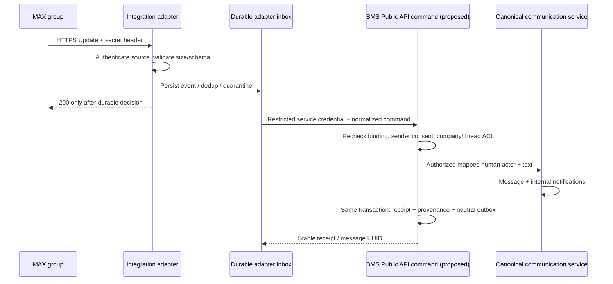

# RC33 — MAX → корпоративная лента: inbound contract

Статус: **DRAFT / GO для архитектурного review; HOLD для реализации и live-пилота**.
Дата проверки: 2026-11-13. Задача: [#85](https://github.com/rimanfatykhov-arch/bms24/issues/85).
База: `main` `4e5c7f31797f7788bb317916f913094d64b5c26e`; plugin `2026111100`, release string `1.1.0-rc29`.
Это проект контракта, не работающая интеграция. Все новые функции, записи и ограничения ниже — предложения, требующие отдельного implementation PR после одобрения владельца.

## 1. Область и источники BMS

[Roadmap #75](https://github.com/rimanfatykhov-arch/bms24/issues/75) задаёт company-scoped ленту; комментарий к задаче ставит BMOS-A0 (#76) перед реализацией actor/API v2. Здесь не принимается альтернативная модель BMOS/SIPOC. Внешний адаптер — `service_integration`, не AI occupant и не сотрудник.

| Проверенный источник на указанной базе | Существующее поведение / следствие |
| --- | --- |
| `local/kbacompany/PUBLIC_API_0.6.5.md`, `db/services.php`, `classes/external/public_api.php` | Public API v1 read-only, restricted users, disabled by default. Inbound write endpoint отсутствует; нельзя выдавать его за существующий метод v1. |
| `classes/local/communication_service.php` (все пути в этой таблице внутри `local/kbacompany`) | Канонические thread/message/participant/notification, типы `direct`, `group`, `object`; доступ участника и object ACL. `send_message()` принимает Moodle actor, создаёт сообщение и внутренние уведомления. |
| `classes/local/communication_object_service.php`, `communication_center_service.php`, `communication_live_service.php` | Контекст объектов, проекции центра и live-чтение; лента должна проецировать разрешённые канонические сообщения, а не копировать их в новую message-модель. |
| `classes/local/communication_service.php::send_message_with_attachment()`; `lib.php` pluginfile | После [#79 / PR #81](https://github.com/rimanfatykhov-arch/bms24/pull/81) текст/файл/только файл сохраняются общей транзакцией; выдача через `can_view_message()`. |
| `PROVIDER_NEUTRAL_OUTBOX_0.6.6.md`, `classes/local/integration_event_service.php`, `platform_event_envelope.php` | `local_kbacompany_eventout`, envelope 1.1, at-least-once, стабильный idempotency key. Сейчас bridge company/employee; публикации communication event в send path нет. Legacy `syncout` независим. |

Issue #79 закрыта; комментарии сообщают merge и подтверждение владельцем работы файлов. Здесь production не проверялся. Старые значения версий в MASTER/AGENTS не заменяют фактический checkout.

Первый slice: одна существующая MAX-группа → одна явно выбранная активная BMS group/object-ветка → новые текстовые сообщения. Это техническая основа ленты, не весь RC33 (реакции, новый UI ленты и модерация остаются вне slice). Direct-ветки, создание задач/решений, outbound MAX, автоматическое добавление участников запрещены.

## 2. Проверка официального MAX API

Проверены официальные страницы 13.11.2026; живой бот и сетевой контракт не испытывались.

| Возможность | Документированный факт | Решение BMS |
| --- | --- | --- |
| API host / изменения | [Changelog](https://dev.max.ru/docs-api/changelog-api): `platform-api2.max.ru`; `GET /chats` снят с поддержки; в части ответов `success:false` добавлен `code`. | Не использовать старый host/discovery. Проверять и HTTP, и business result; не разбирать локализованный `message`. TLS verification не отключать. |
| Webhook | [POST subscriptions](https://dev.max.ru/docs-api/methods/POST/subscriptions/): HTTPS:443, доверенная цепочка; `X-Max-Bot-Api-Secret`; HTTP 200 в течение 30 секунд; до 10 retries, отписка после 8 часов неуспеха. API token передаётся в Authorization. | Secret обязателен в нашем профиле. ACK только после durable приёма. Это shared secret, не HMAC тела и не доказательство личности Moodle. |
| Группы и права | [Bot in chats](https://dev.max.ru/docs-api/use-cases/bot-in-chats-and-channels/): события после добавления бота, `GET /chats/{chatId}/members/me`; чтение списка сообщений требует администратора. | Минимальные права и фактическую доставку сообщений группы проверить в отдельном разрешённом пилоте. Нельзя обещать полный архив или backfill. |
| События | [Update](https://dev.max.ru/docs-api/objects/Update): `message_created`, `message_edited`, `message_removed`, события membership и `bot_admin_permissions_changed`; channel comments имеют отдельные события. | Создание — единственная публикующая операция slice. Edit/delete — review/tombstone, не новый пост; channel comments не импортировать. |
| Данные | [Message](https://dev.max.ru/docs-api/objects/Message): sender, recipient/chat, timestamp в ms, body.mid, вложения и link reply/forward. URL поста не гарантирован для группы. | Идентификаторы хранить без потери int64 как строки; mid opaque. Не выдумывать URL группы и не отождествлять reply с BMS-веткой. |
| Доставка / лимиты | [Event notifications](https://dev.max.ru/docs-api/use-cases/event-notifications/): webhook и polling несовместимы; polling не production; рекомендация максимум 30 rps к API. | Общий limiter на bot connection, retry с jitter. Реальный retry horizon, download-hosts/TTL и права на типы файлов требуют пилота. |

Не доказаны: порядок/полнота доставки, глобальная уникальность mid между ботами/чатами, единый event ID для всех Update, криптографическая подпись тела, бессрочная доступность файлов. Проект не полагается на эти свойства. Подписка/членство в MAX сами по себе не означают согласие на публикацию в BMS.

## 3. Поток и границы доверия



Адаптер имеет собственное ограниченное хранилище inbox; никаких Moodle DB credentials, SQL, файловой системы Moodle или UI/session impersonation. Только BMS Public API. MAX token, webhook secret и BMS service credential — три отдельных секрета, вне Git/URL/logs, с ротацией и отзывом.

**Trust boundary:** BMS аутентифицирует адаптер, но не получает независимого доказательства авторства MAX. Mapping доказывает связь аккаунтов, а не подпись конкретного сообщения. Адаптер, скомпрометированный вместе со своим credential, может сфабриковать текст от разрешённого sender. Повторная проверка DTO этого не устраняет. Принятие такого доверия требует отдельного решения владельца; при его отклонении live-публикация остаётся HOLD до проекта независимой проверки/подтверждения каждого сообщения. Первый fake-provider этап не доказывает authenticity MAX. Для ограничения ущерба: отдельный principal на компанию, только inbound functions, запрет управления mappings/consent, квоты, kill switch; service credential не даёт Public API employees/export или права модерации. Audit показывает «импорт через MAX», а не «подписано пользователем».

Источник connection определяется конфигурацией endpoint/секретом, не полем JSON. Constant-time сравнение secret, запрет дублирующихся auth headers, TLS, лимиты тела/JSON depth и rate limiting до дорогих операций. Предлагаемый ingress budget: 256 KiB, depth 16, ограниченная очередь; превышение → 413, недостоверная auth → 401, временная недоступность durable storage → 503. Не возвращать 200 при потере события.

Аутентифицированные, но неподдерживаемые/неразрешённые события после сохранения минимального решения получают ACK 200: повтор MAX не исправит ACL. Не сохранять произвольные тела неизвестных групп; только keyed fingerprint и reason. Доступ к review очереди компании не даёт права читать чужие группы.

До сохранения body нужна действующая локальная копия BMS-approved binding и consent policy с ограниченным TTL; устаревшая/отсутствующая копия → metadata-only quarantine, без автоматического восстановления body после согласия. Sender без согласия не попадает в raw/review content storage. Per-connection квоты на bytes/count и reserve для control events предотвращают вытеснение одной компанией другой; при заполнении storage — 503 и alert, не ACK/drop. Дубли JSON-ключей, невалидный UTF-8, дробные/exponent IDs и неоднозначные числовые представления отклоняются до нормализации. Значения ID: каноническая decimal string (signed chat ID), без float round-trip; mid — case-sensitive opaque string, без trim/case-folding.

## 4. Привязки, actor и согласие

Предлагаемые BMS-owned записи (не миграции этого PR):

| Запись | Обязательные свойства |
| --- | --- |
| Connection | UUID, provider=max, отдельный service principal, допустимая компания, enabled/revoked, secret reference. Для первого пилота один connection на компанию. |
| Source namespace | BMS-assigned UUID для подтверждённой identity бота; неизменен при ротации credential, пересоздании connection или восстановлении adapter. Не выбирается клиентом. Первый slice запрещает подключать ту же группу через другого бота/компанию для повторного импорта. |
| Group binding | UUID, connection UUID, точный external chat ID, company UUID, thread UUID, revision, active/suspended/revoked, effective_from, approved_by/at, consent policy version. Уникальная активная пара connection+chat, ровно одна цель. |
| Sender binding | company+connection+external sender ID → внутренний Moodle userid и membership UUID; verified_by/at, evidence reference, consent version/scope, effective_from/expires/revoked. Не публиковать внутренние user IDs наружу. |
| Inbound receipt/provenance | Scoped source key, fingerprint, frozen routing revision, receipt UUID, message UUID, integration principal, sender-binding reference, source timestamp, ingestion timestamp, decision/reason, stable correlation UUID. |

Привязку группы утверждает уполномоченный администратор компании с правом на целевую ветку. Смена назначения не перенацеливает backlog: старые события остаются на исходной revision либо уходят в review; ключ дедупликации не меняется при rebind. Перенос группы в другую компанию требует отключения старой связи и отдельного одобрения; старый источник нельзя переимпортировать туда.

Перенос между компаниями и смена бота **не входят в первый этап**. Уникальность active group binding контролируется реестром источников, а не только company-local lookup; обычный caller не может перечислять этот реестр. Согласие привязано к конкретной группе, ветке и версии политики аудитории: добавление новых читателей не означает согласия автора на расширение распространения. В первом пилоте аудитория фиксирована; её изменение приостанавливает импорт до подтверждения новой политики. MAX admin/group membership не заменяет BMS ACL; группа может иметь участников, чьи сообщения импортировать нельзя.

Pause новых imports сам по себе не защищает старую историю: расширение доступа к существующей imported-ветке должно быть запрещено до явного согласования доступа к истории. Без такого согласования создаётся новая ветка с новой audience policy, старые сообщения не копируются. Это требование к административным participant/object ACL writers, а не только worker; если оно не обеспечивается, fixed-audience live-пилот не допускается. Копии policy для адаптера доставляются через доверенный configuration процесс без доступа к employee snapshots; никакой endpoint самоподтверждения consent у bot principal нет.

Сопоставление отправителя — явное подтверждение владения обоими аккаунтами: одноразовый ограниченный по времени challenge из аутентифицированной BMS-сессии и ответ от конкретного MAX account в отдельном разрешённом enrollment-процессе; затем проверка/одобрение компании. Challenge не должен публиковаться в общей группе. Пока enrollment не реализован — только проверенные синтетические mappings для fake-provider. Имя, телефон, email, username и совпавший числовой ID не доказательства. Для публикации от сотрудника нужно его отдельное согласие на импорт из этой группы; администратор группы не заменяет это согласие.

Проверки BMS при каждом исполнении, включая retry/review: разрешённый service principal и command scope; активная binding revision; company совпадает; активная membership автора, аккаунт не suspended/deleted; активное участие в ветке, object ACL и право записи; активная ветка; согласие действует на дату события и исполнения. Отказ закрытый. Не создавать пользователя, employee, participant или права автоматически.

Moodle service user — транспортная учётная запись, не автор. BMS самостоятельно разрешает sender binding и вызывает canonical service с подтверждённым human actor; audit отдельно хранит executing principal. Нельзя принимать `authorid` клиента, подменять глобальный `$USER` или выдавать service user site-admin. Право делегированной записи — новая узкая capability/allowlist в будущем PR, согласуемая с BMOS-A0; текущего v1 viewowncompany недостаточно.

## 5. Предлагаемый Public API command

Отдельная disabled-by-default restricted service `local_kbacompany_public_inbound_v1`, версия контракта `rc33.inbound/1`; функция `local_kbacompany_public_inbound_message` через стандартный Moodle external transport. Имена проектные. Read-only service `local_kbacompany_public_v1` не расширять правом записи молча. В web-service пути проверять credential/context/capability; браузерные административные действия требуют login + sesskey. Bot не получает sesskey человека.

Нормализованный DTO (все значения синтетические):

```json
{
  "schema_version": "rc33.inbound/1",
  "connection_uuid": "11111111-1111-4111-8111-111111111111",
  "binding_uuid": "22222222-2222-4222-8222-222222222222",
  "binding_revision": 1,
  "company_uuid": "33333333-3333-4333-8333-333333333333",
  "thread_uuid": "44444444-4444-4444-8444-444444444444",
  "event_type": "message_created",
  "chat_type": "chat",
  "sender_is_bot": false,
  "link_type": "none",
  "external_chat_id": "-100000000001",
  "external_sender_id": "900000000001",
  "external_message_id": "synthetic-mid-001",
  "source_timestamp_ms": 1794571200000,
  "text": "Синтетическое сообщение для контрактного теста",
  "attachments": [],
  "reply_to_external_message_id": null
}
```

Company/thread в DTO — assertions, сверяемые с BMS binding, не маршрут от клиента. Connection сверяется с credential. Allowlist полей, UUID/строк/типов; не принимать actor, SQL, пути, notification recipients, HTML или произвольный download URL. Для первого slice text после trim обязателен, максимум 20000 символов как в canonical service; markup не интерпретировать, экранировать при выводе. Mentions всегда `[]`; текст `@name` не превращается в Moodle mention.

`chat_type`, `sender_is_bot`, `link_type` обязательны, missing не означает безопасное default. Нормализатор обязан сохранять эти признаки исходного Update; первый slice допускает только `chat`, `false`, `none`, пустые attachments и null reply. Это защита от ошибок нормализации, не от злонамеренного адаптера (§3). `source_timestamp_ms` — целое в допустимом диапазоне; время получения назначается сервером, не клиентом. Новые события старше 24 часов или более чем на 5 минут в будущем относительно первого durable ingress идут в review; события до effective_from binding/consent не публикуются. Эти окна — проектная policy, не гарантии MAX. Уже committed duplicate проверяется по receipt и текущему доступу, не отбрасывается лишь из-за возраста.

Ответ после commit: `{schema_version, outcome: created|duplicate, receipt_uuid, message_uuid, correlation_id}`. Без текста, file URL и user IDs. Для unauthorised caller не раскрывать даже наличие receipt. Durable review: `outcome=review_required`, receipt и безопасный reason, без message UUID. Категории ошибок: `unauthenticated`, `scope_denied`, `binding_stale`, `sender_unverified`, `consent_required`, `thread_unavailable`, `payload_invalid`, `unsupported_attachment`, `idempotency_conflict`, `retryable_unavailable`. Moodle REST может возвращать exception envelope с HTTP 200: клиент проверяет envelope, не только HTTP. HTTP webhook ACK и результат BMS — разные протоколы.

Reply разрешается только через source mapping в той же company+thread и доступное active сообщение; неизвестный parent → review, без поиска по всем компаниям. Первый runnable slice может удерживать все replies. Forward — review, поскольку link.sender не доказывает согласие оригинального автора; автором никогда не становится вложенный sender. Сообщения bot sender, собственные сообщения интеграции и channel/dialog updates не публикуются.

## 6. Идемпотентность и атомарность

1. Source identity = канонический length-prefixed tuple `(provider, source_namespace_uuid, external_chat_id, external_message_id)`; source key = SHA-256 этого tuple + operation `create`. Namespace BMS разрешает по credential/connection (§4). Не включать connection UUID, retry timestamp, binding revision или request UUID. Идентичность company фиксируется в receipt при первом приёме; сверка company обязательна даже при duplicate lookup. Tombstone и create используют общий lock source identity, а не отдельные несвязанные ключи.
2. Fingerprint = SHA-256 канонического семантического DTO (sender, исходный timestamp, text, reply, стабильные attachment identifiers/digests). Не включать временные download URL, secrets, last_activity или имя sender. BMS пересчитывает key/fingerprint; не доверяет присланному hash.
3. BMS unique constraint на source key плюс lock/transaction; не применять только «SELECT затем INSERT». При гонке проигравший откатывает всю попытку, перечитывает committed receipt и возвращает duplicate. Тот же key с другим fingerprint → conflict/review, не перезапись.
4. Одна внешняя delegated transaction: повторная ACL/binding проверка, резервирование receipt, canonical `send_message`, provenance/audit, `integration_event_service::publish`, завершение receipt. Ошибка любого шага откатывает сообщение и внутренние уведомления; duplicate не вызывает send/publish повторно. Lock order фиксирован: company integration gate → binding/sender → source identity. Все пути revoke/disable/смены policy должны использовать тот же gate/согласованный DB lock protocol; локальный lock только в inbound worker недостаточен. Company membership, user suspension, participant/object ACL writers также входят в анализ гонок. Повторное чтение revision без сериализации с writer не закрывает TOCTOU. Если existing writers нельзя безопасно включить в протокол, строгая гарантия не считается реализованной и live остаётся HOLD. Revocation линейризуется в своём commit: более ранний publication commit допустим, более поздний — нет; отзыв не стирает уже прочитанное.
5. BMS commit состоялся, ответ потерян → повтор возвращает тот же UUID. Adapter ACK потерян → тот же путь. Неподтверждённая DB transaction не считается успехом. Crash recovery не создаёт новые request identities.

Для canonical fingerprint фиксировать порядок полей/кодировку UTF-8, отсутствие Unicode normalization текста, различие null/empty и включение `chat_type`, `sender_is_bot`, `link_type`. До hash не отбрасывать признаки, влияющие на разрешение импорта. Fingerprint текста доступен только закрытому receipt/audit: это персональные метаданные, а не анонимизация; в общих logs использовать keyed fingerprint.

Отказы и review не должны откатываться вместе с business transaction: после rollback записывается отдельное минимальное durable decision/audit; success audit — внутри business commit. Если audit отказа недоступен, вернуть retryable failure, не окончательный успех/review. `review_required` означает только сохранённое решение, не разрешение оператору читать содержимое. ACL review проверяет компанию **и** ветку/объект; metadata-only события нельзя вручную превратить в публикацию. Доступный повтор committed receipt не создаёт нового audit success/event, но попытка обращения может иметь отдельный redacted access audit.

Inbound inbox нельзя заменять `eventout`: это разные направления и состояния. Существующий outbox `publish` не является атомарным резервированием inbound key. Новый neutral event предлагается как `communication.message.created`, entity `communication_message`, revision 1, payload `{change: created, thread_uuid}`; envelope 1.1, стабильный correlation из receipt. В нём нет MAX IDs, body, Moodle user IDs, токенов или file URLs. Provider-specific provenance хранится отдельно с ACL. Outbox хранится в той же транзакции; доставка после commit, at-least-once, consumer дедуплицирует event_id и заново проверяет ACL. Read API для сообщения/ленты пока отсутствует в public v1: не обещать fan-out до отдельного scoped read contract. Внутренние уведомления создаёт canonical service, адаптер не дублирует их.

## 7. Вложения, edits и deletion

Issue #79 принимает настоящий HTTP upload (`is_uploaded_file()`); downloaded tempfile адаптера не является таким upload. Запрещено подделывать `$_FILES` или ослаблять эту проверку. Следующий attachment slice: отдельный аутентифицированный multipart ingress BMS с ограничением company/connection/binding/source key, создающий непрозрачный staging handle; затем внутренний сервис потребляет проверенные байты через Moodle File API и общий canonical attachment path. Рефакторинг только отдельным PR с сохранением UI #79.

Handle связан с actor mapping, компанией, веткой, digest, размером, TTL; чужой/reused/expired handle отвергается. На финальном commit повторяются ACL и limits; consume handle, message и attachment reference атомарны, blob cleanup/TTL предусмотрены для rollback/crash. Успех текста с потерянным обещанным файлом запрещён. Сначала один файл, multi-file целиком в review, без частичного импорта.

Download только в адаптере из подтверждённого provider attachment metadata, allowlist HTTPS hosts, DNS/IP проверка до соединения и на каждом redirect; блокировать localhost/private/link-local/metadata endpoints, credentials в URL, rebinding и неограниченные redirects. Потоковый лимит фактических байтов, timeout, MIME sniffing + allowlist, sanitised filename, malware quarantine, запрет активного HTML/SVG/исполняемых файлов. Лимит = минимум PHP/site/company/integration policy; нынешний `get_max_upload_file_size()` сам не доказывает применение site/company лимита или malware-проверку.

Никаких remote images/embed или прямых MAX URLs в ленте. Финальный файл — `local_kbacompany/communication_attachment`, выдача через Moodle pluginfile + текущие company/participant/object ACL, включая revoked user. В первом текстовом slice любое вложение удерживает **всё** сообщение в review; fake/attachment acceptance отдельно от внедрения файлов.

Edit/remove не трактовать как create. Пока автоматическая синхронизация не согласована: durable review по source identity; remove-before-create оставляет tombstone, поздний create блокируется. Редакция-before-create удерживает create до разбора. Оператор действует через разрешённые canonical `change_message` правила, с аудитом; нельзя обходить author-only ограничение сервисным admin. Политику отражения удалений и хранения оригиналов согласовать до live-пилота; автоматическое удаление задач/решений запрещено.

Чтобы это было исполнимо, тот же restricted service должен иметь отдельную проектную control-функцию `local_kbacompany_public_inbound_control`: `{schema_version, connection_uuid, binding_uuid, binding_revision, external_chat_id, external_message_id, event_type, source_timestamp_ms}`; event_type только `message_edited|message_removed`, без body/actor. Она сохраняет BMS-owned hold/tombstone под общим source lock **до** обработки create. Remove idempotent по source identity, edit также устанавливает необратимый для автоматического worker hold; не изобретать provider revision/event ID. Повторный или старый control не снимает hold. Даже если mapping sender отозван, control допустим для аутентифицированного connection и его закреплённого источника: он блокирует автоматический импорт, но не меняет опубликованное сообщение. После rebind/revoke control для старого источника только в закрытый audit/review.

Control на уже опубликованное сообщение создаёт review, не выполняет author-only mutation. Отдельная запись остаётся видна до разрешённого изменения; это существенное ограничение live и предмет решения владельца. `bot_removed`, изменение admin permissions и уход сопоставленного sender приостанавливают соответствующий binding/import lease в адаптере; безопасное возобновление требует повторной проверки прав. BMS не может узнать об утраченном событии мгновенно: production нужен ограниченный по времени, проверяемый health lease, отсутствие которого блокирует новые imports. Проверка полноты событий остаётся pilot gate.

Adapter durable inbox сериализует обработку по source identity; уже полученный control должен установить локальный hold и попасть в BMS до ещё не отправленного create. ACK control означает durable локальное сохранение, не гарантирует, что BMS уже применил его; crash/restart обязан продолжить control доставку. Если create уже committed/находился in-flight раньше control, применяется review опубликованного сообщения. Не заявлять, что неизвестное или ещё не доставленное provider deletion предотвращает более раннюю публикацию.

## 8. Ошибки, аудит и отключение

Состояния adapter inbox: received → validated → pending_bms → committed; альтернативы review_required, retry_wait, rejected, dead_letter. Worker lease с timeout, bounded retries. Для timeout/429/5xx backoff+jitter (предложение: 1s–5min, максимум 12 попыток/24h); учитывать Retry-After, затем dead_letter и alert. Retry не обходит новый отказ ACL. 401/403 останавливают connection, не вызывают бесконечные повторы. MAX outage не блокирует BMS UI. Проверять subscription health: после исчерпания MAX retries нельзя обещать восстановление пропущенных событий без отдельного reconciliation.

Audit: receipt/correlation, company, binding revision, principal, sender-binding reference, UTC received/source/commit times, payload fingerprint, решение/reason, retries, approval/consent reference. Append-only записи доступа и изменений mappings. Обычные logs/metrics без bodies, external IDs, имён файлов, token/secret/URLs; ограниченные internal identity references только в закрытом audit. Counter labels не должны содержать персональные IDs. Метрики: queue age, accepted/rejected/duplicate/conflict, auth failures, dead-letter count, commit latency, outbox backlog; alert на потерю durable storage и отсутствие subscription.

Предлагаемый retention до утверждения: raw encrypted payload только для разрешённой компании и sender с согласием, не более 7 дней; review content 30 дней; минимальные receipt/tombstone без body — на срок жизни source namespace и импортированного сообщения. Истечение review content переводит запись в terminal expired, не сохраняет raw копию в dead-letter. Ротация connection не сбрасывает receipt. Удаление минимальных receipts закрывает namespace для replay; восстановление backup обязано согласованно восстановить messages/receipts/holds/outbox и не включать workers до сверки. Новый namespace для прежнего источника не является способом обхода дедупликации. Стандартные сообщения/files/audit подчиняются согласованной политике BMS и privacy deletion/export, включая резервные копии. Это открытое решение владельца, не существующая настройка.

Kill switch: disable connection + suspend bindings + stop workers, отозвать credential; webhook сохраняет только разрешённые минимальные решения согласно policy. Replay после включения требует повторной ACL/consent и не переносит backlog в новую цель. Уже опубликованные сообщения автоматически не удаляются. Review release никогда не обходится простой кнопкой «force»: нужны исправленные mapping/consent и повторная полная валидация; событие до начала согласия без отдельного разрешения не публикуется.

## 9. Минимальный следующий runnable этап

После одобрения этого контракта и согласования actor/delegation с BMOS-A0 — отдельный PR, без live MAX:

1. Disabled restricted command + BMS-owned binding/sender/receipt schema по отдельно рассмотренной миграции; синтетическая настройка двух компаний, без UI задач.
2. Fake-provider webhook adapter на localhost: fixture → durable inbox → настоящая Moodle external function. Никаких MAX credentials/network. Только plain text `message_created`, одна явная group/thread binding; attachments/replies/edits/forwards проверяют удержание/отказ.
3. Транзакционный wrapper canonical `send_message`, provenance, receipt unique constraint, control hold/tombstone и нейтральный outbox; протокол сериализации с revocation writers. Никакого raw SQL от адаптера; внутри BMS только Moodle DB API и scoped services.
4. Проверить HTTP и конкурентные процессы на Moodle 4.1.22/PHP 8.1, MariaDB/Percona; точные версии окружения подтвердить. Использовать существующие communication_service/center/live, membership_revocation, tenant-isolation suites. Новый API выключен по умолчанию.

Acceptance этого slice: один разрешённый synthetic event создаёт одну canonical запись, одну provenance/receipt и один outbox event; уведомления ровно для разрешённых получателей; повтор/гонка/timeout не увеличивают количества. Негативные случаи не создают дополнительных/неразрешённых публикаций (duplicate и crash-after-commit сохраняют одну законную). `append_message()` сейчас выбирает active participants и отдельно проверяет object context; это не доказательство общей sender/recipient membership и suspended-user проверки. Implementation обязан проверить eligibility получателей внутри канонического notification path и при чтении/доставке, без создания второго outbox уведомлений. Если понадобится изменение общего сервиса, оно должно быть явно включено в scope и regression suite. Live pilot, attachment ingress и полный feed UI — последующие отдельные решения.

### Негативная матрица (план, не выполненные тесты)

| ID | Вход / сбой | Проверяемый результат |
| --- | --- | --- |
| N01 | Нет/неверный/дублирующийся webhook secret | 401; BMS не вызывается, body не логируется. |
| N02 | Malformed JSON, depth/size limit, unsafe int64 conversion | 400/413; нет receipt публикации и сообщения. |
| N03 | Неизвестная группа, channel/dialog, другая connection | Никакой auto-binding; минимальный rejected audit. |
| N04 | Company A credential + binding/thread/company B | scope_denied без чужих UUID/контента; ноль записей B. |
| N05 | Sender отсутствует, имя/ID совпадает с Moodle, is_bot | review/reject; user/employee/participant не создаются. |
| N06 | Mapping есть, согласия нет/отозвано/событие до effective_from | Ноль публикаций, review reason. |
| N07 | Membership revoked, suspended user, не participant, object ACL revoked | Отказ и на первом приёме, и после queue/retry. |
| N08 | Archived thread, stale binding revision/rebind в другую компанию | Не перенаправлять backlog; review, ноль новой цели. |
| N09 | 20 параллельных одинаковых deliveries | Ровно одно сообщение/receipt/event; notification set без дублей. |
| N10 | Commit успешен, ответ потерян; worker crash до/после commit | Retry возвращает прежний результат либо завершает одну новую транзакцию. |
| N11 | Тот же source key, изменённый text/sender/file digest | idempotency_conflict; прежний message неизменен. |
| N12 | Одинаковый mid в разных chat/source namespace; rebind и ротация connection того же источника | Независимые разрешённые источники не схлопываются; ротация/rebind не обходят dedup. |
| N13 | Audit/outbox/file reference failure внутри транзакции | Полный rollback; нет сообщения, notification или доступного orphan file. |
| N14 | Чужой reply, unknown parent, forward original sender | Нет cross-company lookup/impersonation; review. |
| N15 | Пустой/слишком длинный текст, XSS, @mention | Empty/oversize reject; HTML не исполняется, не возникает mention notification. |
| N16 | Attachment в text-only slice | Всё сообщение review, не «успех без файла». |
| N17 | Будущий file slice: SSRF/redirect/DNS rebinding, MIME spoof, превышение streamed size, malware | Download прекращён; ноль опубликованных bytes/message. |
| N18 | Чужой/expired/reused staging handle; download после revocation | Отказ; прямой pluginfile URL не обходит ACL. |
| N19 | Remove/edit раньше create, повтор delete, unsupported update | Tombstone/review; нет нового сообщения или воскресшего содержимого. |
| N20 | BMS 429/503, exception envelope HTTP 200, MAX unavailable | Bounded retry/dead letter, без false success; BMS UI работает. |
| N21 | Отключение connection/смена consent во время worker commit | Сериализованное решение; после revocation новая запись не проходит. |
| N22 | Duplicate после утраты прав; попытка читать audit/review компании B | Нет утечки существующего message UUID/content. |
| N23 | Outbox event доставлен дважды/recipient потерял доступ | Consumer dedup + повторная ACL; никаких outbound MAX messages. |
| N24 | Проверка logs/DTO/fixtures на секреты и персональные данные | Только synthetic values; нет raw payload/token/user ID в публичных артефактах. |
| N25 | Нормализатор опустил bot/forward/chat type, duplicate JSON keys, Unicode/ID ambiguity | Reject без безопасных defaults; fingerprint не теряет security semantics. |
| N26 | Новый connection/secret для того же бота; попытка нового namespace для старой группы | Старый receipt сохраняется; ноль повторных публикаций. |
| N27 | Control и create конкурентны; adapter restart после ACK control | BMS hold не теряется; create после committed hold запрещён. Более ранний create остаётся на review. |
| N28 | Revoke через существующий membership/participant/object writer одновременно с import | Проверка общей сериализации и commit order; тест только inbound lock недостаточен. |
| N29 | Ошибка записи deny audit; истёк consent cache; review content expiry | Нет false terminal success; отсутствующий consent не сохраняет body; expiry не публикует backlog. |
| N30 | Новые читатели ветки; suspended recipient; review operator без object ACL | Pause policy / отсутствие notification leakage / отказ доступа к review body. |
| N31 | Смена часов, delayed duplicate, новый старый event, восстановление backup | Duplicate не публикуется заново; новый старый event удержан; recovery не теряет tombstones. |
| N32 | Удаление бота/потеря permissions, истёк health lease, очередь заполнена | Pause imports, 503 при недолговечном приёме, alert без silent drop. |

Fixture recipe для будущего harness: DTO из §5 + fake registry A с активным sender/participant; копия → duplicate; text изменён при прежнем mid → conflict; company заменена на B → scope_denied; attachments непустой → review; registry consent revoked → consent_required. Каждый результат проверяет DB counts, ACL, audit и отсутствие network calls. Эти примеры не исполняемый тест и не доказательство интеграции.

## 10. Решения владельца и gate

Ни одно предложение ниже пока не считается утверждённым. Для следующего **изолированного fake-provider implementation PR** нужны D1–D4; D5–D8 можно утвердить отдельно до live-пилота. Тестовые policy значения D5–D8 допустимы только в synthetic fixture, без реальных данных.

| ID / gate | Предлагаемое решение для утверждения | Последствие |
| --- | --- | --- |
| D1 / implementation | Только fake-provider, одна группа → одна fixed-audience group/object ветка; text create + control hold; без live MAX, файлов и UI ленты. | Отдельный ограниченный PR, feature disabled. |
| D2 / implementation | Отдельная restricted service с create/control, company-scoped `service_integration`, делегирование только подтверждённому human actor и dual-actor audit, согласованное с BMOS-A0. | Нужны новая capability/allowlist; v1 read-only не меняется. Несогласованный BMOS-A0 оставляет реализацию delegation на HOLD. |
| D3 / implementation | Новые BMS-owned mappings, source namespace, receipts/tombstones/audit; unique constraints, миграция и общий revocation protocol. Разрешить необходимые узкие изменения canonical eligibility/notification path с regression tests. | Scope шире одного endpoint; не обходить существующие ACL и не трогать SIPOC/CI/task UI. Точную схему и миграцию review в следующем PR. |
| D4 / implementation | Gate: реальные synthetic HTTP + concurrency/rollback/revocation тесты на MariaDB и Percona; без claims live authenticity. | При отсутствии общего revocation protocol или потере атомарности результат HOLD, а не упрощённый «PASS». |
| D5 / live | Доверять адаптеру как источнику содержания с явно принятым риском его компрометации (§3), либо потребовать независимое подтверждение каждой публикации. Рекомендуется сначала оставить live HOLD. | Mapping и webhook secret не являются подписью сотрудника; вариант с независимым подтверждением требует другого дизайна. |
| D6 / live | Двусторонний enrollment + отдельное согласие на конкретную группу/ветку/аудиторию; смена аудитории приостанавливает импорт. | Нужны владелец review, проверка прав оператора и видимая метка импортированного сообщения. |
| D7 / live | Edit/delete только hold/review; опубликованное содержимое остаётся до разрешённого canonical изменения. | Если требуется немедленное удаление после MAX delete, текущего slice недостаточно: отдельный moderation/withdrawal contract до live. |
| D8 / live | Retention 7/30 дней + минимальные dedup tombstones; new-event age 24h/future skew 5min; назначенные владельцы ключей, monitoring/review и восстановления. | Требуются согласованные privacy/backup policy, точные cache/health lease TTL, queue budgets, SLA разбора и подтверждённые MAX permissions/delivery. |

Будущие attachment ingress, scoped read API и внешний fan-out требуют самостоятельного контракта и approval. Этот PR меняет только документ; ни DB/ACL/runtime, ни файлы #79 не изменены. **GO для review; HOLD для реализации до D1–D4, HOLD для live до D5–D8 и отдельного разрешения конкретного пилота.**

## 11. Архитектурный/security review PR #88

Проверен первоначальный head `0e7d99f` и исходники на базе §1. Исправлены пробелы проекта: потеря security-признаков DTO, обход dedup через connection rotation, отсутствие BMS control-path, неопределённая сериализация revocation, исчезающий при rollback deny audit, хранение body без согласия, расширение аудитории, недостаточная спецификация notification eligibility и явного доверия адаптеру. Добавлены N25–N32. Это review контракта, не подтверждение отсутствия уязвимостей в будущей реализации и не независимый security sign-off.
