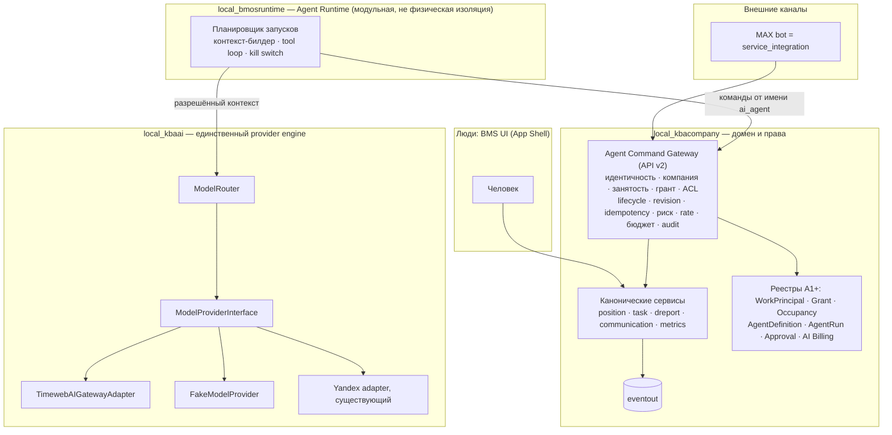

# BMOS-A0. Архитектура BMOS Agent Platform

**Статус: PROPOSED.** Ревизия 2 (25.11.2026): решения Q-01–Q-18, замечания REV-01–REV-10. Решение — [ADR-0013](../adr/ADR-0013-bmos-work-principal-agent-platform-PROPOSED.md).
Ни одна сущность ниже не создана в БД, ни один процесс не запущен. Аудит исходного кода — [A0_00_AUDIT.md](A0_00_AUDIT.md).

## 1. Принципы (из утверждённых решений)

1. **Пост постоянен, исполнитель сменяем** (MR3-D54, #76). Пост — существующая `position.uuid`. Второго реестра должностей нет.
2. **Агент — не пользователь Moodle** (MR3-D55). У него своя идентичность (WorkPrincipal) и узкие гранты. Он не получает роли компании, capability Moodle и сессию человека.
3. **За каждым агентом — ответственный человек** (MR3-D56). Без спонсора агент не активируется.
4. **ИИ предлагает, человек утверждает, домен проверяет, BMS пишет** (BMS-ARC-AI-001 §3). Расширение для агентов (решение Q-09): в A1 агент пишет только собственный результат и предложения; прямые комментарии — после ворот атрибуции W1; R3 — с A2 и только через подтверждение человеком.
5. **Один provider engine — `local_kbaai`** (MR3-D50, BMS-ARC-AI-001 §1.4). Agent Runtime — отдельный плагин `local_bmosruntime` (MR3-D51, Q-02), но модели вызывает через `local_kbaai`.
6. **Fail closed.** Любая неясность в идентичности, компании, занятости, гранте, бюджете или ревизии — отказ без побочных эффектов.

## 2. Слои

- **Agent Command Gateway** живёт в `local_kbacompany`, потому что там домен и права. Он единственный вход для действий нечеловеческих принципалов.
- **Agent Runtime** не имеет доступа к БД домена: читает только через команды (`*.read`, `metrics.read`), пишет только через команды.
- **ModelRouter** выбирает адаптер по профилю модели, хранимому как данные (не код). Модели, цены и лимиты не хардкодятся.

## 3. Путь вызова агента (A3, целевой)

1. Запуск: человек-спонсор или разрешённое расписание создаёт `AgentRun` (`queued`) с ключом идемпотентности.
2. Runtime проверяет kill switch (глобальный → компания → агент → определение), статус принципала, занятость, бюджет; резервирует бюджет.
3. Контекст-билдер вызывает разрешённые `*.read` команды. Ответы уже отфильтрованы по компании и ACL. Недоверенный текст помечается как данные.
4. Runtime вызывает `local_kbaai` ModelRouter → адаптер. В журнал пишутся метаданные, не промпт.
5. Ответ модели — **предложение**. Каждое действие из него становится командой API v2 и проходит все проверки заново.
6. Команды риска R3 в A1 отклоняются без исполнения; с A2 создают `ApprovalRequest`; R4 запрещены.
7. Расход регистрируется идемпотентно, резерв закрывается. Run завершается `succeeded / failed / escalated / cancelled`.

## 4. Где что живёт (предложение)

| Компонент | Компонент Moodle | Обоснование |
|---|---|---|
| WorkPrincipal, Grant, Occupancy, AgentDefinition, AgentRun, Approval, Billing, Command Gateway | `local_kbacompany` | Владелец домена, прав компании, outbox и UI (AGENTS.md) |
| ModelProviderInterface, ModelRouter, адаптеры, профили моделей | `local_kbaai` | Единственный provider engine; уже есть фабрика, mock, профили, fail-closed нормализация |
| Agent Runtime (планировщик, tool loop) | `local_bmosruntime` (решение Q-02) | MR3-D51; выключаемость целиком; не смешивать с Assessor. Изоляция модульная, не физическая — A0_12 §3 |
| Секреты провайдера | Защищённая серверная конфигурация вне Git, затем vault (решение Q-05) | `config_plugins` попадает в бэкапы БД |

## 5. Что A0 не меняет

`task.assigneeid` (исходный Moodle user), `dutypositionuuid` (ответственность поста), `posassign`, `poscover`, историю назначений, защищённые вложения, личные сообщения, календарь, RBAC, права проверяющего, Public API v1, `local_kbaai` Assessor и BMS Assistant, ADR-0012 до A1.

## 6. Принятые в A0 разграничения (для ADR-0013)

- **WorkPrincipal** — кто действует (идентичность). **PositionOccupancy** — на каком посту и с какими функциями. **Grant** — какие команды. **AgentDefinition** — как агент устроен (модель, инструменты, лимиты). **AgentRun** — конкретное выполнение. Это пять разных записей; ни одна не заменяет другую.
- MAX-бот — `service_integration`, не `ai_agent`, и не занимает пост.
- Гибрид — это режим занятости поста (человек в `posassign` + агент в Occupancy с ролью помощника), а не общий всесильный пользователь.

## 7. Противоречия и предлагаемые решения

| # | Противоречие | Источники | Предложение | Статус |
|---|---|---|---|---|
| C1 | Ownership Matrix: canonical ID назначения — «assignment UUID»; в коде у `posassign` нет UUID/ревизии | Drive BMS-ARC-OWN-001 v0.2; `install.xml` | Не менять `posassign` в A1. Для людей Occupancy — производное представление по `posassign`; UUID назначения людей — отдельная задача вне BMOS | Решено Q-07 |
| C2 | ADR-0012: `service_integration` — живой Moodle-аккаунт. ТЗ A0: агент — не пользователь Moodle | #179, ТЗ A0 | Разделить: `ai_agent` — без Moodle user; `service_integration` может иметь **транспортный** аккаунт (токен Moodle требует user), но идентичность — WorkPrincipal UUID. Транспортный аккаунт не автор и не держатель прав | ADR-0013 §6 |
| C3 | MR3-D51 «отдельный Agent Runtime» vs MR3-D50/BMS-ARC-AI-001 «без второго provider engine» | Roadmap 3.0, BMS-ARC-AI-001 | Runtime отдельный, provider engine один (`local_kbaai`) | ADR-0013 §4 |
| C4 | BMS-ARC-AI-001: «AI не меняет статус, не назначает, не создаёт»; MR3-D57/A3: агент сдаёт свой отчёт, предлагает задачи | BMS-ARC-AI-001 §2.5; #76 | Assistant остаётся proposal-only. Агент получает только узкие команды R1–R2 по своей собственной работе; изменение чужих объектов — R3 через подтверждение человека | ADR-0013 §5 |
| C5 | PR #77 предлагает пути `/api/v2/...` (HTTP) | ADR-0007 PROPOSED | В Moodle это external functions `local_kbacompany_v2_*` в выключенном сервисе; логические имена `positions.list` и т. п. сохраняются | A0_04 |
| C6 | ADR-0007 закрепляет за A1 «изолированный адаптер», а Roadmap 3.0 — «A1 ограниченный API/identity, A2 отчётность, A3 помощник руководителя» | ADR-0007, Roadmap 3.0 | Следовать Roadmap 3.0 (утверждён позже). Фейковый адаптер — часть A1, живой Timeweb — не раньше A3 | A0_10 |
| C7 | Timeweb не отдаёт стоимость запроса по API; ТЗ требует confirmed cost | Timeweb docs `/logs`, `/usage-statistics` | `confirmed` — только после сверки с выгрузкой провайдера (CSV/UI или отдельный billing API по согласованию). До этого — `estimated` | A0_06 §6 |
| C8 | `dreport` уникален по `userid`; отчёт агента требует принципала | `install.xml`, MR3-D61 | Отдельное хранение отчётов агентов, общий UI, human `dreport` без миграции | Решено Q-08 |
| C9 | Envelope outbox 1.1 без актора; ТЗ требует атрибуцию | `PROVIDER_NEUTRAL_OUTBOX_0.6.6.md` | Envelope 1.2: добавочные поля актора; потребители 1.1 игнорируют неизвестные поля | A0_06 §5 |
| C10 | `local_kbaai` хранит ключ в `config_plugins` (БД) | `bms_assistant_service::status()` | Для агентной платформы — только ссылка на секрет; существующий путь Assessor не ломать, миграцию ключа предложить отдельно | Решено Q-05 для BMOS |
| C11 | RBAC 2.0 в Drive описывает первый срез (только управленческие циклы); в коде `main` уже применяются `task`/`battle_plan` и ограниченный `department` для людей | Drive RBAC 2.0 (RC28), `access_role_service` | Агенту — только `own`, `assigned`, `explicit_object`, ограниченный `team`; объектная проверка — `principal_object_acl` + грант, без передачи `userid` принципала в человеческие проверки | A0_02 §4.2, §4.3 |
| C12 | «Покрытие» в UI vs Position Coverage | REV-06 | Вакантность людей и функциональное покрытие агентом — разные показатели; `poscover` не используется | A0_02 §3 |
| C13 | In-process Runtime выглядит как граница безопасности | REV-10 | Это не sandbox: доверенный код, allowlist инструментов, статические запреты | A0_12 §3 |
