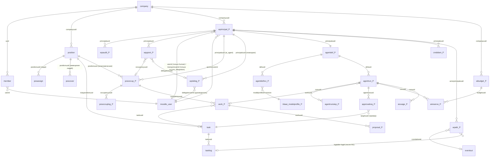

# BMOS-A0. ERD

**Статус: PROPOSED.** Ревизия 2 (25.11.2026): добавлены `wpdeleg`, `proposal`, `cmdidem`, `logtable/logid` в `wpattr`. Существующие таблицы — как в `main` 62fdc49 (повторно сверено с 323f948: схема не менялась). Новые помечены `(P)` и **не утверждены как DDL**.
Все таблицы — с префиксом `local_kbacompany_`, кроме `local_kbaai_*`.

## Ключи и уникальность (проект)

| Таблица (P) | Уникальные ключи | Индексы с компанией первой |
|---|---|---|
| `wprincipal` | `uuid`; `companyuuid+userid` для `human` (через частичное правило в сервисе — Moodle не поддерживает partial index) | `companyuuid, principaltype, status` |
| `wpaudit` | `principaluuid+revision` | `companyuuid, timecreated` |
| `wpgrant` | `uuid` | `companyuuid, principaluuid, status` |
| `wpdeleg` | `uuid` | `companyuuid, principaluuid, status`; `companyuuid, delegatoruserid, status` |
| `posoccup` | `uuid` | `companyuuid, positionuuid, status`; `companyuuid, principaluuid, status` |
| `posoccuplog` | `occupancyuuid+revision` | |
| `agentdef` | `uuid`; `principaluuid` | `companyuuid, status` |
| `agentdefrev` | `defuuid+revno` | |
| `agentrun` | `uuid`; `companyuuid+idempotencykey` | `companyuuid, principaluuid, status`; `companyuuid, timecreated` |
| `agentrunstep` | `runuuid+stepno` | |
| `work` | `uuid`; `companyuuid+idempotencykey` | `companyuuid, principaluuid, status` |
| `proposal` | `uuid` | `companyuuid, workuuid`; `companyuuid, status` |
| `approvalreq` | `uuid`; `companyuuid+requesterprincipaluuid+idempotencykey`; `executionaudituuid` (уникален, если заполнен) | `companyuuid, status, approveruserid`; `status, expiresat` |
| `aibudget` | `uuid` | `companyuuid, scope, scopeuuid` |
| `aireserve` | `uuid`; `runuuid+stepno+attemptno+budgetuuid` | `status, expiresat` (включая `uncertain`) |
| `aiusage` | `uuid`; `runuuid+stepno+attemptno` | `companyuuid, timecreated`; `companyuuid, status` |
| `wpattr` | `uuid`; `logtable+logid` (если заполнено) | `companyuuid, objecttype, objectuuid`; `companyuuid, actorprincipaluuid, timecreated` |
| `cmdidem` (ключи идемпотентности команд: digest, `status` `pending_approval`/`executed`/`failed`/`rejected`/`expired`/`cancelled`, `approvaluuid`, сохранённый результат, `expiresat` ≥ max(30 дней, горизонт повтора, срок approval)) | `companyuuid+principaluuid+idempotencykey` | `expiresat`; `approvaluuid` |
| `local_kbaai_modelprofile` | `id+revision` | |

Все выборки — с `companyuuid` в условии SQL (AGENTS.md: не фильтровать в PHP после выборки всех компаний).

## Связь с ADR-0012 (#179)

`local_kbacompany_inbconn` (#179) в отдельном срезе A1-12 (после приёмки контура MAX) получает ссылку на `wprincipal(service_integration)`; `principaluserid` →
`wprincipal.transportuserid`. Поведение импорта не меняется. Подробно — ADR-0013 §6 и A0_10 §3.
